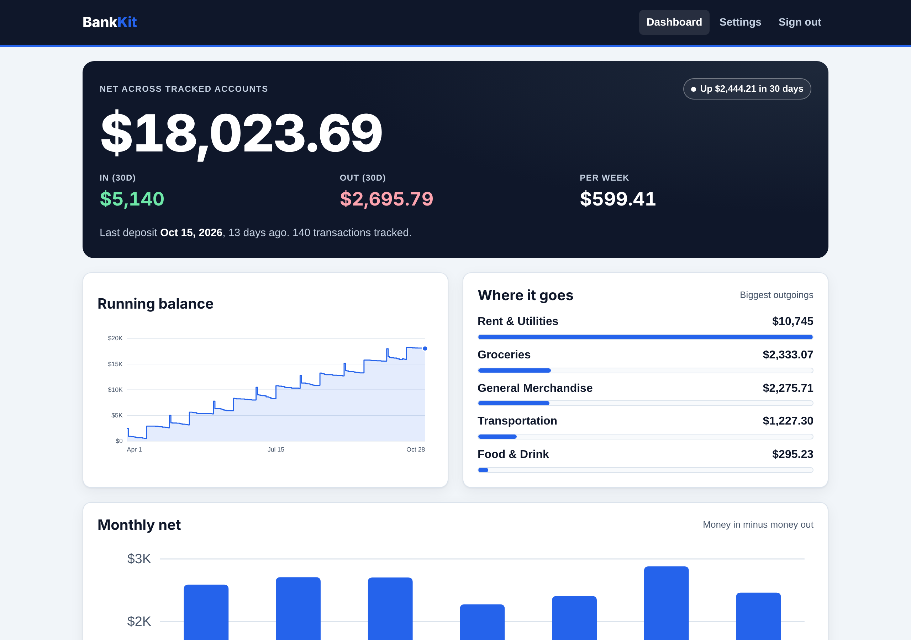
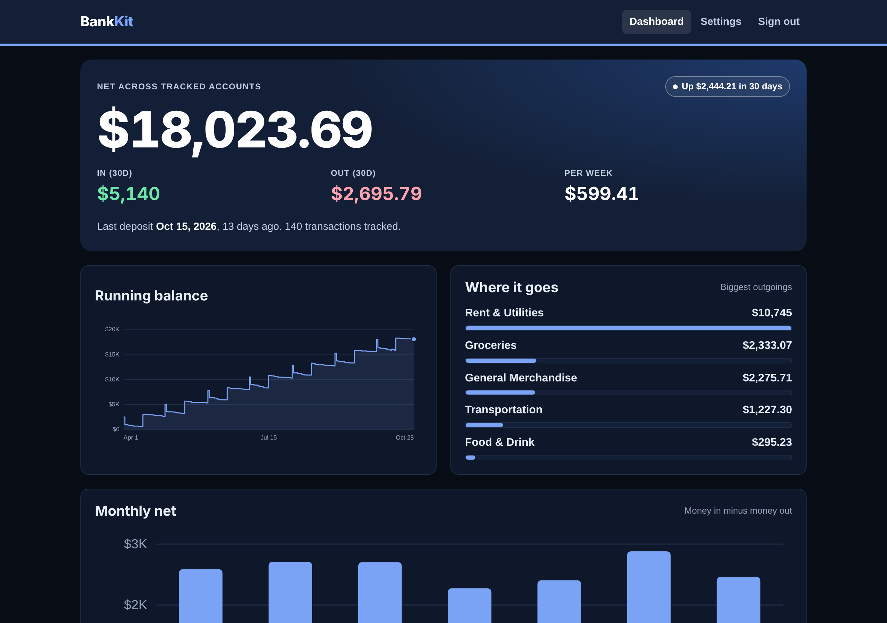
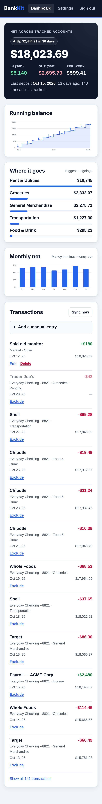

<div align="center">

# BankKit

**Production-ready Plaid + Supabase + Next.js starter.**
Ship a bank-connected app this weekend instead of next month.

[**→ Get BankKit ($49)**](https://warizko.gumroad.com/l/xvomtz)

</div>

---

## The problem

Plaid's quickstart gets you a list of transactions in an afternoon. Then you
spend the next two weeks on the parts nobody blogs about:

- Webhook signatures you have to verify yourself (ES256 JWT against a rotating
  key set, body hash, replay window) — skip it and anyone can POST fake
  transactions into your database
- Access tokens that must be encrypted at rest and never reach the browser
- `/transactions/sync` cursor handling, including the mid-pagination mutation
  error that makes you restart the whole page loop
- Re-consent flows, because banks expire access every 90–180 days and your app
  has to notice and ask the user to fix it
- OAuth redirect banks, which break the normal Link popup flow entirely
- Row Level Security so user A can't read user B's bank balance

BankKit is those two weeks, already written, typed, and running in production.

## What you get

A complete Next.js 15 app, not a tutorial repo.

| | |
|---|---|
| 🔐 **Auth** | Supabase magic links, session refresh middleware, optional email allowlist |
| 🏦 **Plaid** | Link token, token exchange, `/transactions/sync` with cursors, account tracking, re-consent (update mode), OAuth redirect page, item removal |
| 📩 **Webhooks** | Full ES256 signature verification, cached key fetch, 5-minute replay window, constant-time body hash compare |
| 🔑 **Encryption** | AES-256-GCM for access tokens and webhook URLs, bound to the owning user id as AAD, so a stolen ciphertext can't be replayed onto another row |
| 🛡️ **Database** | Postgres schema with RLS on every table, column-level grants — the browser role literally cannot select the token column |
| ⏰ **Scheduled jobs** | Daily cron: safety sync of every connection, plus per-user digests in their own time zone, with double-send guards |
| 🔔 **Notifications** | Email (Resend), Telegram bot with a one-time link flow, Discord webhooks |
| 📊 **Dashboard** | Hand-built SVG charts with hover tooltips, no chart library, light + dark, mobile-first |
| ✅ **Tests** | 25 passing tests covering the money math, the crypto round-trip, and webhook forgery/replay/tamper cases |

**Stack:** Next.js 15 (App Router, Server Actions) · TypeScript strict · Supabase · Plaid · Resend · Vercel. No UI framework, no CSS framework, ~3,500 lines you can actually read.

## This code is in production

BankKit was extracted from a live personal-finance app running against **Navy
Federal Credit Union** with real Plaid production access. The sync loop, the
webhook verification, and the re-consent flow aren't theoretical — they're
handling real transactions right now.

## Screenshots



| Dark mode | Mobile |
|---|---|
|  |  |

## Quick start

```bash
npm install
cp .env.example .env.local     # fill in the values
npm run gen:secrets            # prints ENCRYPTION_KEY and CRON_SECRET
npm run dev
```

Then:

1. Create a Supabase project and run `supabase/migrations/0001_init.sql` in the SQL editor.
2. Add `http://localhost:3000/auth/callback` to Supabase → Authentication → URL Configuration.
3. Grab your Plaid sandbox keys from the Plaid dashboard.
4. Sign in, connect a sandbox bank with `user_good` / `pass_good`, and watch transactions arrive.

Full deployment guide, including the Vercel cron and the Plaid production
checklist, is in [`docs/DEPLOY.md`](docs/DEPLOY.md).

## Project map

```
app/
  dashboard/         balance, charts, categories, transactions (+ server actions)
  settings/          bank connections, account tracking, notifications, delete account
  settings/oauth/    return page for OAuth banks
  login/, auth/      magic-link sign-in and callback
  api/plaid/         link token, exchange, re-consent, signed webhook
  api/cron/sync      daily job: sync every item + send due digests
  api/telegram/      one-time chat linking
lib/
  plaid.ts           typed Plaid REST client (fetch, no SDK)
  sync.ts            cursor-based transaction sync, re-consent detection
  plaid-verify.ts    webhook signature verification (pure, unit-tested)
  crypto-core.ts     AES-256-GCM (pure, unit-tested)
  summary.ts         the money math — swap this file for your own domain logic
  notify.ts          email / Telegram / Discord delivery
  data.ts            one call that loads everything a page needs
supabase/migrations/ schema, grants, RLS policies
```

## Make it yours

The kit is deliberately thin where your product is thick:

- **`lib/summary.ts`** is the only file that decides what the numbers mean.
  Replace it with budgets, runway, net worth, whatever you're building.
- **`lib/messages.ts`** holds every outgoing message. Two constants at the top
  rebrand all of them.
- **`app/globals.css`** is one `:root` token block. Change the colors, the
  whole app follows.

## FAQ

**Does this work outside the US?**
Yes. Plaid supports the US, Canada, UK, and much of the EU. Set
`PLAID_COUNTRY_CODES`. The OAuth redirect page is included because most EU
banks require it.

**Do I need Plaid production access?**
Not to build. Sandbox works out of the box with test credentials. Plaid's free
Trial plan covers up to 10 live connections when you're ready.

**What's the hosting cost?**
$0 to start. Vercel Hobby, Supabase free tier, and Resend free tier cover a
personal app or an early product.

**Can I use this for a client project?**
Yes. One license covers one developer building unlimited apps. See
[LICENSE.md](LICENSE.md).

**Is there a refund policy?**
Yes — 14 days, no questions asked. Email me.

---

<div align="center">

### Stop rebuilding Plaid plumbing.

**[Get BankKit — $49](https://warizko.gumroad.com/l/xvomtz)**

One-time payment · Unlimited projects · 14-day refund

</div>
